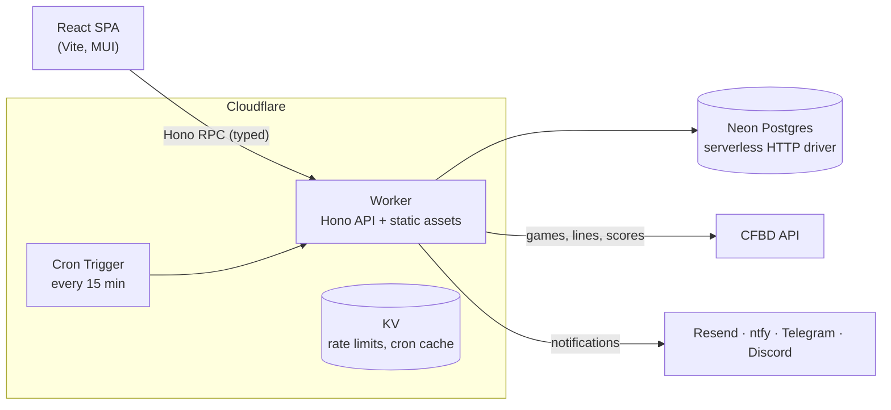

# CFB Pickem Leagues

[](https://github.com/Labnerd-net/cfb-pickem-leagues/actions/workflows/ci.yml)
[](LICENSE)

A multi-league College Football Pick'em app. Friends join private leagues, pick the winner of each week's games before kickoff, and compete on live leaderboards. Scores sync automatically from [College Football Data](https://collegefootballdata.com/), and reminders and results go out by email, ntfy, Telegram, or Discord.

**Live site: [cfbpickem.labnerd.net](https://cfbpickem.labnerd.net/)** · In production with real users, running on Cloudflare Workers and Neon Postgres.

<!-- TODO: add 2-3 screenshots or a short GIF (taken from the dev Worker, not prod, to avoid real user data)


-->

## Features

- **Private leagues.** Join by invite link (`/join/<code>`). Each league has its own game pool, picks, leaderboards, members, and roles.
- **Weekly picks with lock times.** Per-game kickoff enforcement, a countdown on each card, and a warning when the first game is about to lock with unsaved picks. Games that have started are shown as results while later games stay pickable.
- **Season and weekly leaderboards.** Ranked by pick percentage with a minimum-participation threshold and shared ranks for ties.
- **Automated scoring.** A cron job refreshes scores during game windows. Admins can sync from CFBD manually and correct scores, with an audit trail.
- **Notifications.** 24-hour and 1-hour pick reminders and a results-final message, per user (email) and per league (ntfy, Telegram, Discord).
- **Admin tooling.** Game curation from CFBD, league and member management, user CSV export, and broadcast messages.

## Architecture



A single Worker serves both the API and the built frontend. `packages/shared` holds the types used by both sides.

## Engineering Highlights

- **End-to-end type safety without codegen.** The backend exports its Hono `AppType`, and the frontend builds a typed RPC client from it. A route change that breaks a caller fails at compile time. Response types are inferred, including `Date` to string serialization over JSON.
- **Designed around the serverless HTTP driver.** Neon's HTTP driver has no connection pool and no interactive transactions. Multi-statement writes use `db.batch()` for atomicity, and bulk imports use a single multi-row `INSERT ... ON CONFLICT` instead of ~70 parallel requests. That change fixed an intermittent 500 on game import caused by request fan-out.
- **Cost-aware cron.** The 15-minute cron decides whether it is inside a real game window using actual kickoff times (first kickoff minus 25h to last kickoff plus 12h). Outside a window it caches the next check time in KV and exits without touching the database, so Neon can autosuspend in the off-season. Before this, the cron kept the database awake about 8 hours a day with zero users.
- **Idempotent, league-scoped notifications.** A `notification_log` table with a unique key on `(user, league, week, type, channel)` prevents double sends across cron restarts. A user in two leagues gets one message per league.
- **Security hardening from audits.** Examples: stored-XSS escaping in email templates, SSRF mitigation on user-supplied webhook URLs, rate-limiter IP-spoofing protection behind `TRUST_PROXY`, a sole-admin guard on account and league deletion, expiring email-verification tokens, and PBKDF2 password hashing via Web Crypto.
- **Safe release process.** Feature branches are deployed to a separate `dev` Worker backed by a Neon dev branch before merging to `main`. Verifying there caught bugs that mocked tests could not.
- **Testing.** Backend route and DB tests run against in-process PGlite (no external database). The frontend uses Vitest with MSW-mocked API calls. A local season simulation (`seed:dev` plus a pinned clock) replays real 2024 games end to end.

## Tech Stack

| Layer | Technology |
|-------|-----------|
| Frontend | React 19, React Router, Material-UI, React Hook Form + Zod, Vite |
| Backend | Hono (typed RPC client shared with the frontend), Drizzle ORM, JWT auth (httpOnly cookie) |
| Database | PostgreSQL on [Neon](https://neon.tech), via the serverless HTTP driver |
| Hosting | Cloudflare Workers (API + static frontend assets, cron trigger, KV) |
| Shared | TypeScript types in `packages/shared` |
| Tooling | pnpm workspaces, TypeScript, ESLint, Prettier, Vitest, MSW, PGlite |

## Project Structure

```
packages/
  backend/    # Hono API (routes, Drizzle DB functions, CFBD adapter, notifications, cron)
  frontend/   # React SPA
  shared/     # Shared TypeScript types
docs/         # Development, notifications, and simulation guides
context/      # Feature specs, plans, and change history
wrangler.jsonc  # Cloudflare Workers config (prod + dev environments)
```

## Run Locally

Requires Node 22+, pnpm, a Neon database (a dev branch works well), and a free [CFBD API key](https://collegefootballdata.com/). Environment variable details are in [docs/DEVELOPMENT.md](./docs/DEVELOPMENT.md#environment-setup).

```bash
pnpm install
cd packages/backend && pnpm migrate && cd ../..
pnpm dev:backend     # API on http://localhost:3000
pnpm dev:frontend    # Frontend on http://localhost:5173
```

The first registered user becomes the site admin and gets a Default League. Admins import a week's schedule from CFBD and choose which games each league can pick.

## More Documentation

- [docs/DEVELOPMENT.md](./docs/DEVELOPMENT.md): environment setup, scripts, testing, and local season simulation
- [docs/NOTIFICATIONS.md](./docs/NOTIFICATIONS.md): notification types, channels, and configuration
- [docs/SIMULATION.md](./docs/SIMULATION.md): season simulation details

## License

[MIT](./LICENSE)

## Deployment

Production runs on Cloudflare Workers with a Neon `PROD_DB`. A separate `dev` Worker environment (reading `DEV_DB`, cron disabled) is used to verify branches before merge.

```bash
pnpm build
pnpm --filter cfb-pickem-api deploy:worker       # production
pnpm --filter cfb-pickem-api deploy:worker:dev   # dev environment
```

Secrets are set once per environment with `wrangler secret put <KEY>` (add `--env dev` for the dev Worker). See `wrangler.jsonc` for the required list.
